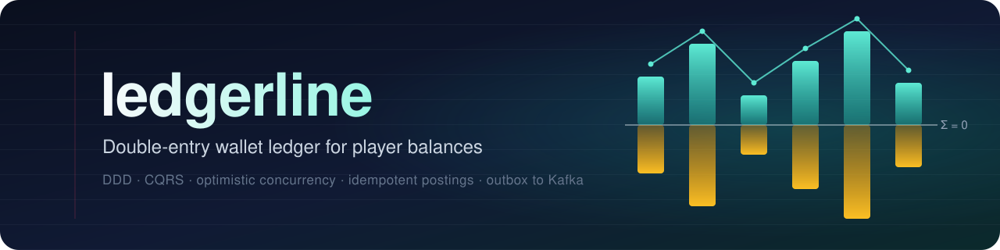
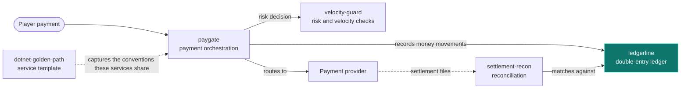
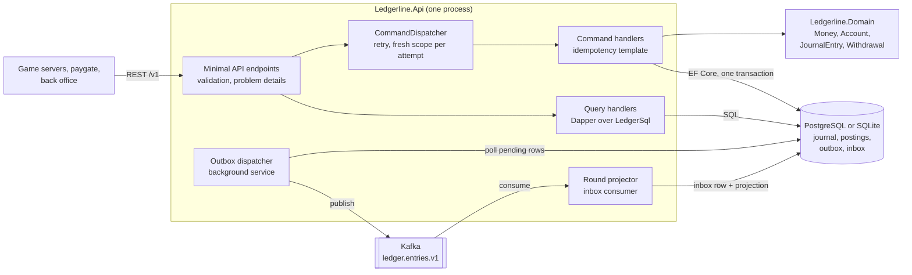
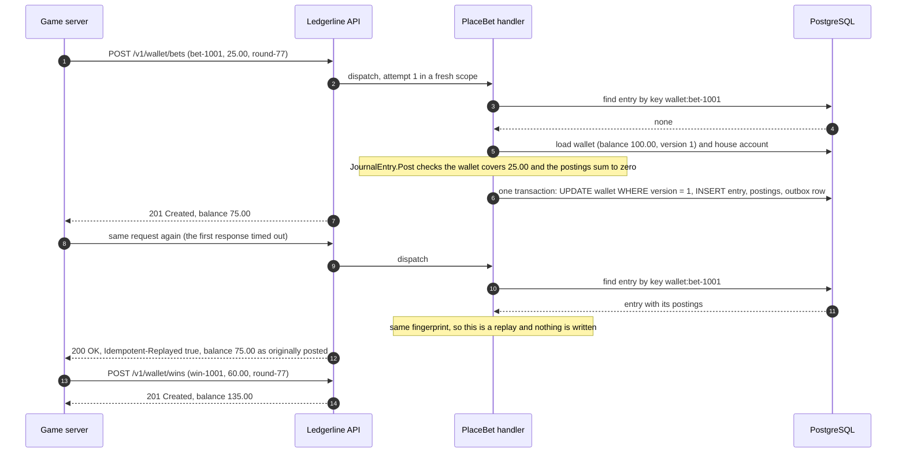
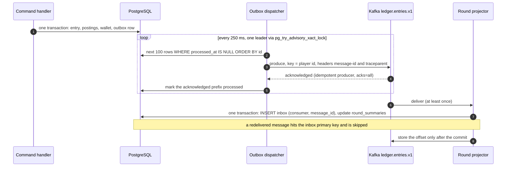

<div align="center">



# 📒 Ledgerline

**Double-entry wallet ledger for player balances: DDD and CQRS on EF Core and PostgreSQL, optimistic concurrency, idempotent postings and a transactional outbox to Kafka.**

[](https://github.com/AutumnTrace/ledgerline/actions/workflows/ci.yml)
[](https://github.com/AutumnTrace/ledgerline/actions/workflows/codeql.yml)
[](https://github.com/AutumnTrace/ledgerline/releases)


[](LICENSE)

[Why](#-why-this-exists) · [Features](#-features) · [Quick start](#-quick-start) · [Architecture](#-architecture) · [Examples](#-example-requests) · [Decisions](#-design-decisions) · [Testing](#-testing) · [Performance](#-performance) · [Changelog](CHANGELOG.md)

</div>

## 💡 Why this exists

A player's wallet balance is money the operator owes them, and every bet, win, deposit and payout moves some of it. A single `balance` column can tell you what a player has, but not where it came from, why the books are off by EUR 12.40, or whether a retried bet was charged twice. Ledgerline records every movement as a balanced double-entry journal entry, so every cent has a source and a destination and all balances always sum to zero. It is built for the realities of a seamless-wallet integration: game servers retry on timeouts, payment providers send the same callback twice, and a dozen bets can hit one wallet in the same millisecond.

## ✨ Features

| | |
|---|---|
| 📒 **Double-entry journal** | Every movement is a `JournalEntry` whose postings sum to zero per currency; corrections are new, reversing entries |
| 💶 **Exact money** | Integer minor units with ISO 4217 currencies (EUR 2, JPY 0, KWD 3 digits); checked arithmetic, no rounding, no currency mixing |
| 🔁 **Idempotent commands** | Every command is keyed on the caller's transaction id: a replay returns the original result and balances, a different payload with the same id is a 409 |
| 🎰 **Seamless wallet flows** | Bet debit, win credit and bet rollback with round ids; deposits from a PSP; withdrawal hold, complete and reverse; bonus grants and wallet transfers |
| 🏁 **Optimistic concurrency** | Version-checked wallets with a bounded, jittered retry in a fresh unit of work; house accounts never become a hot row |
| ✂️ **CQRS** | EF Core aggregates on the write side; Dapper and hand-written SQL over covering and partial indexes on the read side |
| 📑 **Keyset pagination** | Account statements with an opaque cursor; page 500 costs the same as page 1 |
| 📤 **Transactional outbox** | Events committed with the entry, relayed to Kafka in order, at least once, by a single leader |
| 📥 **Inbox deduplication** | The sample consumer applies each message exactly once, however often it is delivered |
| 🧯 **Problem details** | RFC 9457 errors with stable codes ([catalogue](docs/errors.md)), OpenAPI 3.1 and a Scalar UI |
| 🔭 **Observability** | Serilog, OpenTelemetry traces across HTTP, the outbox and Kafka; metrics for postings, retries and outbox lag |
| 🧪 **Tested for real** | Property-based tests over random command histories, concurrency tests, Testcontainers on PostgreSQL 18 and Kafka 4 |
| 🐳 **Ship-ready** | Chiseled non-root multi-arch image, compose stack, health probes, CI with coverage, query plans and an end-to-end smoke test |

## 🧩 Part of Payments Lab

Ledgerline is one of five services that together sketch the payments side of a B2B iGaming platform. Each repository builds, tests and runs on its own.

| Repository | What it does |
|---|---|
| [paygate](https://github.com/AutumnTrace/paygate) | Payment orchestration gateway: PSP routing and failover, Polly circuit breakers, idempotent REST API, signed webhooks |
| **[ledgerline](https://github.com/AutumnTrace/ledgerline)** 📍 **you are here** | **Double-entry wallet ledger: DDD + CQRS on EF Core/PostgreSQL, optimistic concurrency, transactional outbox to Kafka** |
| [settlement-recon](https://github.com/AutumnTrace/settlement-recon) | Settlement reconciliation engine: streams PSP settlement files against the ledger, explains every mismatch |
| [velocity-guard](https://github.com/AutumnTrace/velocity-guard) | Real-time payment risk and velocity checks on Redis: sliding windows, HybridCache, sub-millisecond rule evaluation |
| [dotnet-golden-path](https://github.com/AutumnTrace/dotnet-golden-path) | `dotnet new` template for production .NET services: OpenTelemetry, Serilog, resilience, Testcontainers, Docker, Helm, CI |



## 🚀 Quick start

### Option A: just .NET (SQLite, in-memory transport, nothing else to install)

```bash
git clone https://github.com/AutumnTrace/ledgerline.git
cd ledgerline
dotnet run --project src/Ledgerline.Api --launch-profile http
```

Open **http://localhost:5180/scalar** for the API reference. The SQLite database (`ledgerline.db`) is created on first run, and the outbox relays to an in-process channel and the log instead of Kafka, so the whole pipeline runs with no infrastructure.

### Option B: Docker Compose (PostgreSQL 18 + Kafka 4)

```bash
docker compose up --build
```

The API is at **http://localhost:8080/scalar**, with schema migrations applied on startup. Kafka is reachable from the host at `localhost:9094`; watch the ledger stream with:

```bash
docker compose exec kafka /opt/kafka/bin/kafka-console-consumer.sh \
  --bootstrap-server localhost:9092 --topic ledger.entries.v1 --from-beginning --property print.key=true
```

### Option C: the published image

Each release is published to the GitHub Container Registry for `linux/amd64` and `linux/arm64`:

```bash
docker run --rm -p 8080:8080 ghcr.io/autumntrace/ledgerline:0.1.0
```

On its own the image uses SQLite (in a writable `/data` directory) and the in-memory transport. Point it at PostgreSQL and Kafka with the variables in [Configuration](#%EF%B8%8F-configuration), as [`docker-compose.yml`](docker-compose.yml) does.

## 🏗 Architecture



The **domain** project has no dependencies: money, accounts and the balancing rules are plain C# and unit-tested in isolation. The **application** layer holds the commands, the idempotency template and the dispatcher. **Infrastructure** implements the write store with EF Core, the read side with Dapper, and the outbox, Kafka and inbox. Reads never load aggregates; writes never use the read SQL.

### Money flows

Each command posts one balanced entry. Signs are from the account's point of view: `+` moves money in.

| Command | Endpoint | Postings |
|---|---|---|
| Deposit settled | `POST /v1/deposits` | PSP clearing `-X`, player cash `+X` |
| Bet | `POST /v1/wallet/bets` | player cash `-X`, house `+X` |
| Win | `POST /v1/wallet/wins` | house `-X`, player cash `+X` |
| Bet rollback | `POST /v1/wallet/rollbacks` | the exact mirror image of the bet |
| Withdrawal requested (hold) | `POST /v1/withdrawals` | player cash `-X`, PSP suspense `+X` |
| Withdrawal completed | `POST /v1/withdrawals/{id}/complete` | PSP suspense `-X`, PSP clearing `+X` |
| Withdrawal reversed | `POST /v1/withdrawals/{id}/reverse` | PSP suspense `-X`, player cash `+X` |
| Bonus granted | `POST /v1/bonuses` | bonus pool `-X`, player bonus `+X` |
| Wallet transfer | `POST /v1/transfers` | one wallet `-X`, the other `+X` |

Read endpoints: `GET /v1/players/{playerId}/wallets`, `/v1/accounts/{id}`, `/v1/accounts/{id}/statement?limit&cursor`, `/v1/entries/{id}`, `/v1/withdrawals/pending`, `/v1/rounds/{roundId}`, `/v1/ledger/trial-balance`. The schema, constraints and the reason for every index are in [`docs/data-model.md`](docs/data-model.md).

### A bet, a timeout retry and a win



If two bets race for the same wallet, one `UPDATE … WHERE version = 1` affects no rows. The dispatcher re-runs that command from scratch in a new scope (fresh `DbContext`, fresh balance), with exponential backoff and jitter, up to five retries.

### From commit to Kafka



## 🧪 Example requests

Real responses, captured from Option A on a fresh database. Long ids are shortened with `…`, JSON is folded onto fewer lines, and bodies marked *trimmed* show only the fields that matter.

<details open>
<summary><b>Deposit</b> settled by a payment provider</summary>

```bash
curl -i -X POST http://localhost:5180/v1/deposits -H "Content-Type: application/json" \
  -d '{"transactionId":"psp-7f3a91","provider":"northwind-pay","playerId":"p-1001","currency":"EUR","amountMinor":10000}'
```

```http
HTTP/1.1 201 Created
Location: /v1/entries/01a20880-18b0-78f1-8db5-8c1d370bb808
```

```json
{
  "entryId": "01a20880-18b0-78f1-8db5-8c1d370bb808",
  "type": "DepositSettled",
  "transactionId": "psp-7f3a91",
  "playerId": "p-1001",
  "postedAt": "2026-11-23T13:02:22.384029+00:00",
  "replayed": false,
  "balances": [
    { "accountId": "01a20880-18ae-…", "accountCode": "player:p-1001:cash:EUR", "wallet": "Cash",
      "balance": { "minor": 10000, "currency": "EUR", "amount": "100.00" } }
  ],
  "postings": [
    { "accountId": "01a20880-1882-…", "accountCode": "psp:northwind-pay:clearing:EUR", "accountType": "PspClearing",
      "amount": { "minor": -10000, "currency": "EUR", "amount": "-100.00" }, "balanceAfter": null },
    { "accountId": "01a20880-18ae-…", "accountCode": "player:p-1001:cash:EUR", "accountType": "PlayerCash",
      "amount": { "minor": 10000, "currency": "EUR", "amount": "100.00" },
      "balanceAfter": { "minor": 10000, "currency": "EUR", "amount": "100.00" } }
  ]
}
```
</details>

<details open>
<summary><b>Bet</b>, then the <b>same bet again</b> (idempotent replay)</summary>

```bash
curl -i -X POST http://localhost:5180/v1/wallet/bets -H "Content-Type: application/json" \
  -d '{"transactionId":"bet-1001","playerId":"p-1001","roundId":"round-77","currency":"EUR","amountMinor":2500}'
```

```http
HTTP/1.1 201 Created
Location: /v1/entries/01a20880-1975-747f-82a2-e204571adb01
```

```json
{
  "entryId": "01a20880-1975-747f-82a2-e204571adb01",
  "type": "BetDebit",
  "transactionId": "bet-1001",
  "playerId": "p-1001",
  "postedAt": "2026-11-23T13:02:22.58144+00:00",
  "replayed": false,
  "balances": [
    { "accountId": "01a20880-18ae-…", "accountCode": "player:p-1001:cash:EUR", "wallet": "Cash",
      "balance": { "minor": 7500, "currency": "EUR", "amount": "75.00" } }
  ],
  "postings": [
    { "accountId": "01a20880-18ae-…", "accountCode": "player:p-1001:cash:EUR", "accountType": "PlayerCash",
      "amount": { "minor": -2500, "currency": "EUR", "amount": "-25.00" },
      "balanceAfter": { "minor": 7500, "currency": "EUR", "amount": "75.00" } },
    { "accountId": "01a20880-1975-…", "accountCode": "house:gaming:EUR", "accountType": "HouseGaming",
      "amount": { "minor": 2500, "currency": "EUR", "amount": "25.00" }, "balanceAfter": null }
  ]
}
```

Sending the identical request again (say, after a timeout) posts nothing and returns the original result: the same `entryId`, `postedAt` and balance of 75.00, with `"replayed": true` and this status:

```http
HTTP/1.1 200 OK
Idempotent-Replayed: true
```
</details>

<details>
<summary><b>Business errors</b>: overdraft, transaction id reuse, invalid input</summary>

A bet larger than the wallet (after a 60.00 win the balance is 135.00):

```http
HTTP/1.1 422 Unprocessable Entity
Content-Type: application/problem+json
```

```json
{
  "type": "https://github.com/AutumnTrace/ledgerline/blob/main/docs/errors.md#insufficient-funds",
  "title": "Insufficient funds.",
  "status": 422,
  "detail": "Account player:p-1001:cash:EUR has 135.00 EUR available, 9999.99 EUR was requested.",
  "code": "insufficient-funds",
  "accountCode": "player:p-1001:cash:EUR",
  "availableMinor": 13500,
  "requestedMinor": 999999,
  "traceId": "00-41b17e0a961628583328d6d0a5bf5f81-52c461d5504291f9-03"
}
```

Posting a win with the bet's transaction id (bets, wins and rollbacks share one id space):

```json
{
  "type": "https://github.com/AutumnTrace/ledgerline/blob/main/docs/errors.md#idempotency-key-reused",
  "title": "Idempotency key reused with a different request.",
  "status": 409,
  "detail": "Idempotency key 'wallet:bet-1001' was already used for a different request.",
  "code": "idempotency-key-reused",
  "traceId": "00-43c0dff924b72a11b1dcf9b7602e7d27-911cd8ac1e24c25b-03"
}
```

A malformed bet, rejected by .NET 10's built-in validation before any handler runs:

```json
{
  "type": "https://tools.ietf.org/html/rfc9110#section-15.5.1",
  "title": "One or more validation errors occurred.",
  "status": 400,
  "errors": {
    "TransactionId": ["The field TransactionId must match the regular expression '^[A-Za-z0-9][A-Za-z0-9._-]{0,63}$'."],
    "RoundId": ["The RoundId field is required."],
    "AmountMinor": ["The field AmountMinor must be between 1 and 1000000000000."]
  },
  "traceId": "00-6952884536573475bdc87564335e8fcb-e9d025011f888968-03"
}
```
</details>

<details>
<summary><b>Withdrawal</b>: hold, list open holds, complete (trimmed)</summary>

```bash
curl -X POST http://localhost:5180/v1/withdrawals -H "Content-Type: application/json" \
  -d '{"withdrawalId":"wd-5001","provider":"northwind-pay","playerId":"p-1001","currency":"EUR","amountMinor":4000}'
```

```json
{
  "entryId": "01a20880-1e2f-725f-b76a-996279423597",
  "type": "WithdrawalReserved",
  "transactionId": "wd-5001",
  "balances": [ { "accountCode": "player:p-1001:cash:EUR", "balance": { "minor": 9500, "currency": "EUR", "amount": "95.00" } } ],
  "postings": [
    { "accountCode": "player:p-1001:cash:EUR", "amount": { "minor": -4000, "currency": "EUR", "amount": "-40.00" }, "balanceAfter": { "minor": 9500, "currency": "EUR", "amount": "95.00" } },
    { "accountCode": "psp:northwind-pay:suspense:EUR", "amount": { "minor": 4000, "currency": "EUR", "amount": "40.00" }, "balanceAfter": null }
  ]
}
```

```bash
curl http://localhost:5180/v1/withdrawals/pending
```

```json
[
  { "withdrawalId": "wd-5001", "playerId": "p-1001", "provider": "northwind-pay",
    "amount": { "minor": 4000, "currency": "EUR", "amount": "40.00" }, "requestedAt": "2026-11-23T13:02:23.791089+00:00" }
]
```

`POST /v1/withdrawals/wd-5001/complete` then moves the hold from suspense to PSP clearing (`"type": "WithdrawalCompleted"`, `"balances": []`: no wallet changes). A later `reverse` is a `409 invalid-state`.
</details>

<details>
<summary><b>Statement</b> with keyset pagination (trimmed)</summary>

```bash
curl "http://localhost:5180/v1/accounts/01a20880-18ae-73ab-8385-9f5ba041e29b/statement?limit=2"
```

```json
{
  "account": { "code": "player:p-1001:cash:EUR", "type": "PlayerCash", "balance": { "minor": 9500, "currency": "EUR", "amount": "95.00" },
               "balanceSource": "stored", "version": 4 },
  "items": [
    { "postingId": 7, "entryType": "WithdrawalReserved", "amount": { "minor": -4000, "currency": "EUR", "amount": "-40.00" },
      "balanceAfter": { "minor": 9500, "currency": "EUR", "amount": "95.00" }, "postedAt": "2026-11-23T13:02:23.791089+00:00" },
    { "postingId": 6, "entryType": "WinCredit", "amount": { "minor": 6000, "currency": "EUR", "amount": "60.00" },
      "balanceAfter": { "minor": 13500, "currency": "EUR", "amount": "135.00" }, "postedAt": "2026-11-23T13:02:22.981275+00:00" }
  ],
  "nextCursor": "AQAAAAAAAAAG"
}
```

`?limit=2&cursor=AQAAAAAAAAAG` returns the bet and the deposit, with `"nextCursor": null`.
</details>

<details>
<summary><b>Round totals</b> (fed asynchronously through the outbox) and the <b>trial balance</b></summary>

```bash
curl http://localhost:5180/v1/rounds/round-77
```

```json
{
  "roundId": "round-77",
  "playerId": "p-1001",
  "bets": { "minor": 2500, "currency": "EUR", "amount": "25.00" },
  "wins": { "minor": 6000, "currency": "EUR", "amount": "60.00" },
  "rolledBack": { "minor": 0, "currency": "EUR", "amount": "0.00" },
  "net": { "minor": -3500, "currency": "EUR", "amount": "-35.00" },
  "entries": 2,
  "updatedAt": "2026-11-23T13:02:23.2434533+00:00"
}
```

```bash
curl http://localhost:5180/v1/ledger/trial-balance
```

```json
{
  "balanced": true,
  "currencies": [
    {
      "currency": "EUR",
      "net": { "minor": 0, "currency": "EUR", "amount": "0.00" },
      "balanced": true,
      "lines": [
        { "accountType": "HouseGaming", "accounts": 1, "balance": { "minor": -3500, "currency": "EUR", "amount": "-35.00" } },
        { "accountType": "PlayerCash", "accounts": 1, "balance": { "minor": 9500, "currency": "EUR", "amount": "95.00" } },
        { "accountType": "PspClearing", "accounts": 1, "balance": { "minor": -6000, "currency": "EUR", "amount": "-60.00" } },
        { "accountType": "PspSuspense", "accounts": 1, "balance": { "minor": 0, "currency": "EUR", "amount": "0.00" } }
      ]
    }
  ]
}
```

The player holds 95.00; the house is 35.00 down on the round; the provider has paid in 100.00 and out 40.00. It nets to zero.
</details>

## 🧠 Design decisions

- **A journal, not a balance column.** Balances are derived from immutable, balanced postings; wallets cache theirs in the same transaction. [ADR 1](docs/adr/0001-double-entry-journal-over-balance-columns.md)
- **Integer minor units with an explicit currency.** Exact sums, a zero-sum check that is a real equality, and no silent rounding. [ADR 2](docs/adr/0002-money-as-integer-minor-units.md)
- **Optimistic concurrency on wallets, no stored balance on operator accounts.** Wallets are version-checked and retried in a fresh scope; the house account is never updated, so bets on different wallets never contend. [ADR 3](docs/adr/0003-optimistic-concurrency-and-hot-accounts.md)
- **Transactional outbox and inbox instead of dual writes.** No lost or phantom events; delivery is at least once and consumers deduplicate. [ADR 4](docs/adr/0004-transactional-outbox-over-dual-writes.md)
- **CQRS with a small hand-rolled dispatcher and Dapper reads.** The retry behaviour that matters is explicit; read SQL is visible and its plans are checked in CI. [ADR 5](docs/adr/0005-cqrs-with-a-hand-rolled-dispatcher-and-dapper-reads.md)
- **Idempotency is enforced by the database**, not only checked in code: a unique index on the idempotency key, a partial unique index so a bet can be reversed once, and a request fingerprint so a reused id with a different payload is rejected.
- **A replay returns exactly the original result**: each posting stores the wallet balance after it, and timestamps are truncated to the microsecond PostgreSQL keeps, so the stored entry reads back identical to the first response.
- **Hot paths log through source-generated `LoggerMessage`**, and nothing logs request bodies.

## ✅ Testing

```bash
dotnet test --filter "Category!=Integration"   # no Docker needed
dotnet test tests/Ledgerline.IntegrationTests   # Docker: PostgreSQL 18 and Kafka 4 via Testcontainers
```

| Suite | Tests | What it proves |
|---|---:|---|
| `Domain/*` | 45 | Money (precision, overflow, currency mixing), currencies, accounts, the balancing rules of `JournalEntry`, the withdrawal state machine |
| `Properties/*` (CsCheck) | 5 | Random leg sets: balanced ones post, unbalanced ones never do; random movements never overdraw a wallet; **300 random command histories** (deposits, bets, wins, rollbacks, withdrawals, bonuses, transfers, replays) through the real handlers: every entry balances, **all balances sum to zero** per currency, stored balances equal their postings, suspense equals open withdrawals, replays are identical |
| `Application/*` | 27 | Every command on SQLite, idempotent replays and key reuse, rollbacks, the withdrawal lifecycle, statement cursors, and **40 parallel bets on one wallet** with real thread-pool parallelism (never overdrawn, unbroken balance-after chain) |
| `Api/*` | 22 | HTTP contract through `WebApplicationFactory`: 201 vs 200 replay, problem details for every error class, keyset paging, round totals arriving through the outbox, health and OpenAPI |
| `Infrastructure/*` | 10 | Outbox written in the same transaction, commit-order publishing, a mid-batch failure retried with nothing skipped, lag and Degraded health, trace context, inbox dedup, migrations match the model |
| `IntegrationTests` | 9 | On **PostgreSQL 18 and Kafka 4**: index definitions, **100 parallel bets** under real row locks (in CI: exactly 20 posted, 80 rejected for insufficient funds, 580 conflict retries, none exhausted), concurrent duplicates, a racing complete and reverse, a random parallel workload that keeps the books balanced, the Dapper read side, entries reaching Kafka in order with headers, and redelivered messages ignored by the inbox |

Across both suites, line coverage is 88% and branch coverage 60.9% (ReportGenerator, EF migrations excluded, from the same CI run as the query plans). CI runs both suites, merges coverage into the job summary, builds the image, and drives the compose stack end to end with [`scripts/smoke-test.sh`](scripts/smoke-test.sh) before reading the messages back from Kafka.

## 🔭 Observability

| Signal | What you get |
|---|---|
| **Metrics** (meter `Ledgerline`) | `ledger.commands` and `ledger.command.duration` by command and outcome · `ledger.entries.posted` and `ledger.postings` by entry type (postings per second is their rate) · `ledger.concurrency.retries` by command · `ledger.outbox.published`, `ledger.outbox.publish_failures`, `ledger.outbox.delivery_delay` · gauges `ledger.outbox.pending` and `ledger.outbox.lag` · plus ASP.NET Core, HttpClient and runtime metrics |
| **Traces** (source `Ledgerline`) | `ledger.command {Name}` spans with idempotency key, entry id and outcome · one `ledger.entries.v1 publish` producer span per message · `ledger.entries.v1 process` consumer spans, all parented on the original HTTP request through the `traceparent` header · ASP.NET Core and Npgsql spans |
| **Logs** | Serilog with request logging; readable console text locally, compact JSON in the container. Business rejections are Information, lost races Debug, exhausted retries Warning |
| **Exporters** | OTLP when `OTEL_EXPORTER_OTLP_ENDPOINT` is set; Azure Monitor (Application Insights) when `APPLICATIONINSIGHTS_CONNECTION_STRING` is set |
| **Health** | `/health/live` (process up) and `/health/ready` (database, plus outbox lag: Degraded past 30 s, so writes keep flowing while the broker is down) |

## ⚡ Performance

### BenchmarkDotNet

Measured on this development machine; the full command runs single-threaded against a SQLite file in WAL mode, so its time includes a durable commit to local disk.

```
BenchmarkDotNet v0.15.8, Windows 11 (10.0.26200.7623/25H2/2025Update/HudsonValley2)
AMD Ryzen 7 9800X3D 4.70GHz, 1 CPU, 16 logical and 8 physical cores
.NET SDK 10.0.401
  [Host]     : .NET 10.0.12 (10.0.12, 10.0.1226.42308), X64 RyuJIT x86-64-v4
  DefaultJob : .NET 10.0.12 (10.0.12, 10.0.1226.42308), X64 RyuJIT x86-64-v4
```

| Benchmark | Mean | Allocated |
|---|---:|---:|
| `JournalEntry.Post`, 2 legs (validate, apply, raise event) | 250.6 ns | 1.4 KB |
| `JournalEntry.Post`, 10 legs | 493.8 ns | 3.86 KB |
| `PlaceBet` end to end (idempotency check, loads, posting, outbox row, commit) | 590.81 μs | 134.51 KB |
| `PlaceBet` replay (answered from the stored entry) | 83.79 μs | 48.39 KB |

The domain logic is under a microsecond; the write path is dominated by I/O and the commit. Run them with `dotnet run -c Release --project benchmarks/Ledgerline.Benchmarks -- --filter '*'`.

### Query plans on PostgreSQL

CI's `query-plans` job seeds a PostgreSQL 18.7 service container with 50,003 accounts, 1.05 million journal entries, 2.1 million postings, 100,000 withdrawals (1,000 open) and a million outbox rows (250 pending), runs `VACUUM ANALYZE`, then records `EXPLAIN (ANALYZE, BUFFERS)` for the exact SQL the service runs. Numbers from [this run](https://github.com/AutumnTrace/ledgerline/actions/runs/45180358434) on a GitHub-hosted runner, second execution of each query; every plan is in [`docs/query-plans.md`](docs/query-plans.md).

| Query | What the plan does | Time | Buffers |
|---|---|---:|---:|
| Idempotency check (first query of every command) | Index scan on `ix_journal_entries_idempotency_key`, then `ix_postings_entry_id` | 0.087 ms | 8 |
| Statement, first page (player with 50,000 postings) | **Index Only Scan Backward** on `ix_postings_account_statement`, 51 rows, heap fetches 0 | 0.048 ms | 5 |
| Statement, page 500 by keyset cursor | The same scan, seeking with `id < @Before` | 0.049 ms | 6 |
| Statement, page 500 by `OFFSET` (contrast, not used) | The same scan, reading 25,051 index entries to return 51 | 2.302 ms | 573 |
| Player wallets | Index scan on the partial `ix_accounts_owner_id_type` | 0.061 ms | 4 |
| Entry with its postings | `ix_postings_entry_id`, then the accounts primary key | 0.059 ms | 12 |
| Open withdrawal holds | Index scan on the partial `ix_withdrawals_pending` | 0.071 ms | 102 |
| Outbox, next batch of 100 | Index scan on the partial `ix_outbox_messages_pending` | 0.052 ms | 3 |
| Derived balance of the house account | Index-only scan over its 1,000,000 postings | 138.885 ms | 22,735 |

Keyset paging costs the same at any depth, while `OFFSET` already takes 47 times as long at page 500 and reads 95 times as many buffers. Every statement read is index-only thanks to the `INCLUDE` columns. The one expensive query is the honest cost of [not storing operator balances](docs/adr/0003-optimistic-concurrency-and-hot-accounts.md): summing a million house postings takes about 139 ms, which is fine for a dashboard but is why balance snapshots are first on the roadmap.

## ⚙️ Configuration

| Key | Default | Description |
|---|---|---|
| `Database:Provider` | `Sqlite` | `Sqlite` or `Postgres` |
| `ConnectionStrings:Ledger` | `Data Source=ledgerline.db` | Write-side connection string |
| `ConnectionStrings:LedgerRead` | the primary | Optional read replica for the query side |
| `Database:InitializeOnStartup` | `true` | Apply migrations (PostgreSQL) or create the schema (SQLite) |
| `Ledger:Concurrency:MaxRetries` | `5` | Retries after a lost optimistic-concurrency race |
| `Ledger:Concurrency:BaseDelay` | `00:00:00.010` | First backoff delay; doubles per attempt, with jitter |
| `Messaging:Transport` | `InMemory` | `InMemory` or `Kafka` |
| `Messaging:Topic` | `ledger.entries.v1` | Topic for ledger entries |
| `Messaging:Kafka:BootstrapServers` | `localhost:9092` | Required for Kafka |
| `Messaging:Kafka:ConsumerGroup` | `ledgerline-round-projector` | Group of the in-process projector |
| `Messaging:Kafka:CreateTopic` | `true` | Create the topic at startup (`TopicPartitions` 3, `ReplicationFactor` 1) |
| `Messaging:EnableRoundProjection` | `true` | Host the round-summary consumer in this process |
| `Outbox:Enabled` | `true` | Run the relay in this process |
| `Outbox:PollingInterval` / `BatchSize` | `250 ms` / `100` | Relay cadence |
| `Outbox:LagWarningThreshold` | `00:00:30` | Readiness turns Degraded past this lag |
| `OTEL_EXPORTER_OTLP_ENDPOINT` | unset | Enables OTLP export |
| `APPLICATIONINSIGHTS_CONNECTION_STRING` | unset | Enables Azure Monitor export |

Every key can be set through environment variables, e.g. `Messaging__Kafka__BootstrapServers=kafka:9092`. Options are validated on startup, so a bad value stops the app instead of failing on the first request.

## 📁 Project layout

```
ledgerline/
├── src/
│   ├── Ledgerline.Domain/          # Money, Currency, Account, JournalEntry, Withdrawal. No dependencies
│   ├── Ledgerline.Application/     # Commands + handlers, idempotency template, CommandDispatcher, query contracts
│   ├── Ledgerline.Infrastructure/  # EF Core write model + migrations, Dapper read model (LedgerSql),
│   │                               # outbox dispatcher, Kafka and in-memory transports, inbox projector
│   └── Ledgerline.Api/             # Minimal API endpoints, problem details, OpenAPI + Scalar, Serilog, OpenTelemetry
├── tests/
│   ├── Ledgerline.Tests/           # Domain, CsCheck properties, application (SQLite), API, outbox
│   └── Ledgerline.IntegrationTests/# Testcontainers: PostgreSQL 18 and Kafka 4
├── benchmarks/
│   ├── Ledgerline.Benchmarks/      # BenchmarkDotNet
│   └── Ledgerline.QueryPlans/      # Seeds PostgreSQL and records EXPLAIN (ANALYZE, BUFFERS)
├── docs/                           # ADRs, data model, error catalogue, banner
├── scripts/smoke-test.sh           # End-to-end check used by CI against a running stack
├── Dockerfile · docker-compose.yml
└── .github/                        # CI, release to GHCR, CodeQL, Dependabot, templates
```

## 🗺 Roadmap

- [ ] Periodic balance snapshots for operator accounts: their derived balance is an aggregate that grows with history
- [ ] Retention for published outbox rows and old inbox rows
- [ ] Service-to-service authentication (mTLS or OAuth client credentials); today the API expects to sit behind the platform's internal gateway
- [ ] Bonus wagering rules and cash-then-bonus bet funding (bets currently debit cash only)
- [ ] Reject rollbacks of bets whose round has already paid out, and record tombstones for rollbacks that arrive before their bet
- [ ] Change data capture (Debezium) as an alternative relay at higher volume

## 📄 License

[MIT](LICENSE) © Mina Rotari
