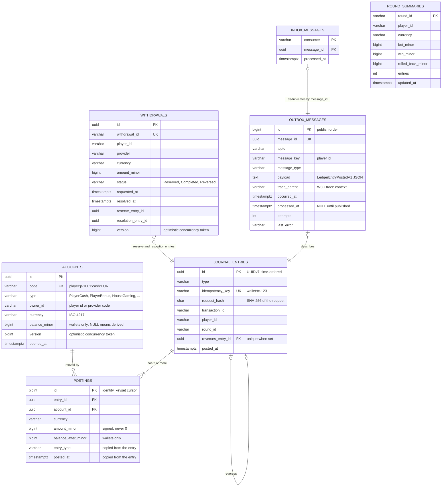

# Data model

The schema is managed by EF Core: versioned migrations for PostgreSQL
([`Persistence/Migrations`](../src/Ledgerline.Infrastructure/Persistence/Migrations)), and the same model
created directly on SQLite for local runs and the fast test suite. Names are snake_case. A unit test
fails if the model drifts from the migrations.

`withdrawals`, `outbox_messages` and `inbox_messages` reference entries and messages by id without a
foreign key: they are written in the same transaction as what they point to, and the inbox may see
messages from other producers. `round_summaries` is a projection fed from Kafka, not part of the write model.

## Tables

| Table | Written by | Purpose |
|---|---|---|
| `accounts` | Commands (opened on first use) | Chart of accounts. One row per wallet or operator account and currency. |
| `journal_entries` | Commands | One row per business operation, identified by its idempotency key. |
| `postings` | Commands | The money movements. Append-only; the source of truth for every balance. |
| `withdrawals` | Withdrawal commands | Payout lifecycle (`Reserved → Completed` or `Reversed`). |
| `outbox_messages` | Commands (same transaction) / dispatcher | Events waiting to be published, then the publish record. |
| `inbox_messages` | Consumers | Messages a consumer has already applied. |
| `round_summaries` | Round projector | Per-round totals for the seamless wallet. |

## Constraints that back up the domain

| Constraint | Rule |
|---|---|
| `ck_accounts_wallet_not_negative` | `balance_minor IS NULL OR balance_minor >= 0`. The domain refuses overdrafts first; this is the last line. |
| `ck_postings_amount_not_zero` | `amount_minor <> 0`. |
| `ix_journal_entries_idempotency_key` (unique) | Two racing copies of one request cannot both commit; the loser's retry finds the winner and replays it. |
| `ix_journal_entries_reverses_entry_id` (unique, partial) | A bet can be rolled back at most once, even by concurrent rollbacks with different transaction ids. |
| `ix_accounts_code` (unique) | Concurrent first-time writers cannot open the same wallet twice. |
| `ix_withdrawals_withdrawal_id` (unique) | One payout per caller id. |
| `version` concurrency tokens | `UPDATE … WHERE id = @id AND version = @expected` on wallets and withdrawals; zero rows means someone else won, and the command is retried. |

## Indexes and why each exists

| Index | Definition | Serves |
|---|---|---|
| `ix_postings_account_statement` | `(account_id, id) INCLUDE (entry_id, entry_type, amount_minor, balance_after_minor, posted_at)` | Account statements with keyset pagination. Everything the statement returns is in the index, so a page is an **index-only scan** walked backwards from the newest posting, stopping after `limit + 1` rows. The same index gives the derived balance of an operator account (sum of `amount_minor`) without touching the heap. `entry_type` and `posted_at` are copied onto postings precisely so this query needs no join. |
| `ix_postings_entry_id` | `(entry_id)` | Loading an entry's postings (replays, `GET /v1/entries/{id}`). Also the FK index. |
| `ix_journal_entries_idempotency_key` | unique `(idempotency_key)` | The first query of every command: has this already happened? |
| `ix_accounts_owner_id_type` | `(owner_id, type) WHERE owner_id IS NOT NULL` | A player's wallets. House accounts have no owner and stay out of the index. |
| `ix_withdrawals_pending` | `(requested_at) WHERE status = 'Reserved'` | Open holds, oldest first. **Partial**: resolved withdrawals pile up forever, but the index only holds the operations backlog. |
| `ix_outbox_messages_pending` | `(id) WHERE processed_at IS NULL` | The dispatcher's poll, in publish order. **Partial**: millions of published rows, an index the size of the backlog. |
| `ix_outbox_messages_message_id` | unique `(message_id)` | Message identity across retries. |

### Why keyset pagination

`OFFSET n` makes the database produce and discard `n` rows before returning a page, so page 500 is 500
times the work of page 1. The statement cursor is the id of the last posting on the previous page;
`WHERE account_id = @AccountId AND id < @Before ORDER BY id DESC LIMIT @Take` seeks directly into the
index, so every page costs the same. The cursor is an opaque, versioned base64url token, so its contents
can change without breaking clients. Posting ids come from an identity column; for player wallets, whose
writes are serialised by the version check, they are also in commit order.

## Measured query plans

CI's `query-plans` job seeds a PostgreSQL 18 service container with 50,000 wallets, about 1.05 million
journal entries, 2.1 million postings, 100,000 withdrawals and a million outbox rows, runs
`VACUUM ANALYZE`, then records `EXPLAIN (ANALYZE, BUFFERS)` for the exact SQL the service runs. Each run
publishes the report in its job summary; [`query-plans.md`](query-plans.md) is the report from one run.

| Query | Plan | Time |
|---|---|---:|
| Statement, first page (50,000-posting player) | Index Only Scan Backward on `ix_postings_account_statement`, heap fetches 0 | 0.048 ms |
| Statement, page 500 by keyset cursor | Same scan, `id < @Before` | 0.049 ms |
| Statement, page 500 by `OFFSET` (not used) | Same scan, 25,051 entries read to return 51 | 2.302 ms |
| Idempotency check | `ix_journal_entries_idempotency_key`, then `ix_postings_entry_id` | 0.087 ms |
| Open withdrawal holds | Partial `ix_withdrawals_pending` | 0.071 ms |
| Outbox poll | Partial `ix_outbox_messages_pending` | 0.052 ms |
| Derived house balance (1M postings) | Index-only scan of every house posting | 138.885 ms |
